# Практическая работа №6: Ansible Roles и Continuous Integration (GitHub Actions)

## Выполнил: [Абубакиров Артур]

### Шаг 1. Разработка структуры роли Ansible
- В директории `~/devops_lab6_roles` создана модульная структура роли `nginx-vhosts` (`tasks`, `handlers`, `templates`).
- Разработан шаблон Jinja2 для виртуальных хостов Nginx (`site.conf.j2`) с динамическим определением `server_name` и корневого каталога `root`.
- Разработан шаблон стартовой страницы (`index.html.j2`).

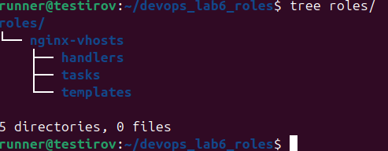
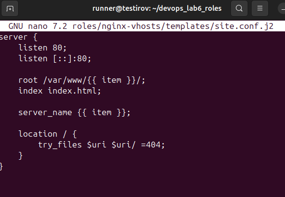

### Шаг 2. Разработка задач роли (Tasks) и обработчиков (Handlers)
- В `handlers/main.yml` описан вызов службы `systemd` для перезапуска Nginx по событию.
- В `tasks/main.yml` реализован пайплайн:
  1. Установка пакета `nginx`.
  2. Итеративное создание директорий `/var/www/{{ item }}/` через цикл `loop: "{{ sites }}"`.
  3. Рендеринг и раскладка конфигураций сайтов в `/etc/nginx/conf.d/` с вызовом `notify: restart nginx`.
  4. Размещение персонализированных файлов `index.html` для каждого виртуального хоста.

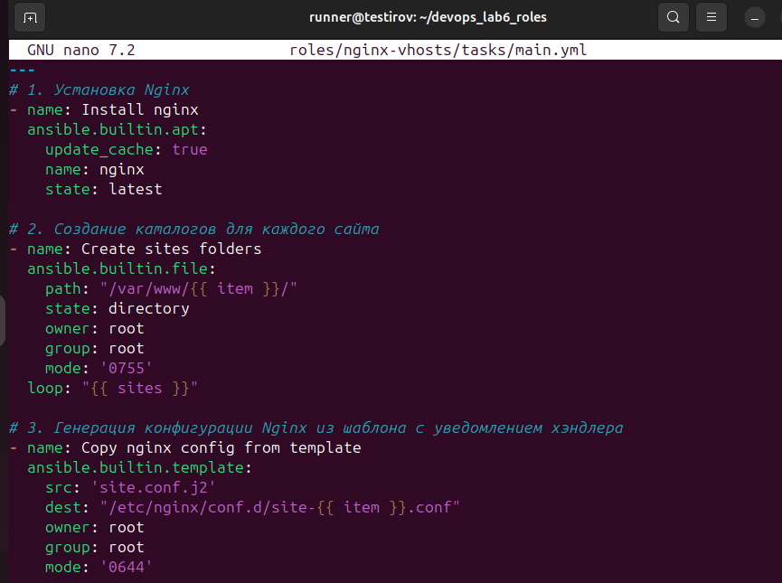

### Шаг 3. Конфигурация сценария, деплой роли и тестирование vhosts
- Создан инвентарный файл `inventory.ini` с указанием целевого хоста `10.0.2.4`.
- Разработан плейбук `playbook.yml`, вызывающий роль `nginx-vhosts` и передающий список виртуальных хостов (`etis.com`, `fizfak.com`, `mehmat.ru`).
- Подготовлен скрипт запуска `run_playbook.sh` с флагом `--diff`.
- Сценарий успешно выполнен на целевом сервере.

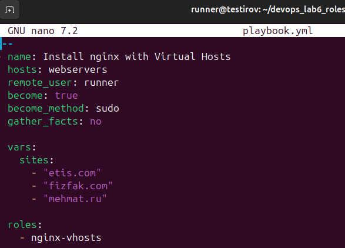
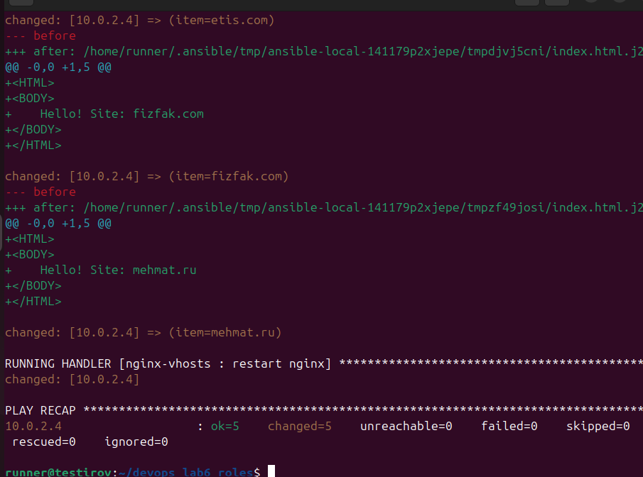

### Шаг 4. Проверка изоляции виртуальных хостов
- Выполнено тестирование через передачу заголовка `Host` утилитой `curl`:
  - `curl 10.0.2.4 -H 'Host: fizfak.com'`
  - `curl 10.0.2.4 -H 'Host: mehmat.ru'`
  - `curl 10.0.2.4 -H 'Host: etis.com'`
  Сервер корректно возвращает изолированное содержимое для каждого домена.
- В файле `/etc/hosts` прописана привязка доменных имен к IP целевого хоста, проверено прямое обращение по DNS-имени: `curl http://fizfak.com`.

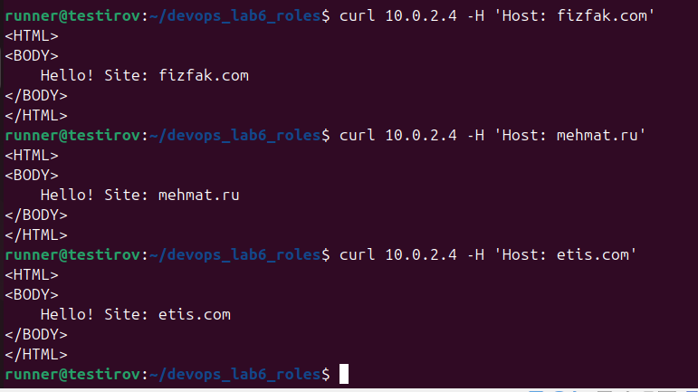
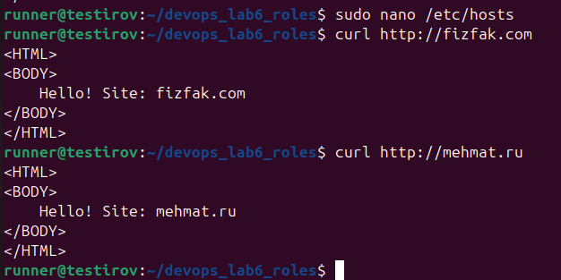

### Шаг 5. Интеграция с GitHub Actions и запуск тестового CI-раннера
- Создан публичный репозиторий на GitHub, в настройках активированы разрешения для GitHub Actions (*Allow all actions and reusable workflows*).
- Все исходные коды роли отправлены в ветку `master`.
- Разработан базовый пайплайн `.github/workflows/devops_course_pipeline.yml`, реагирующий на событие `push`.
- Пайплайн запускается на облачном агенте `ubuntu-latest` и выполняет диагностические команды (`uptime`, `pwd`, `whoami`).
- Успешность прохождения проверена во вкладке Actions репозитория.

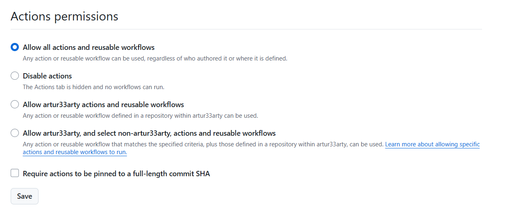

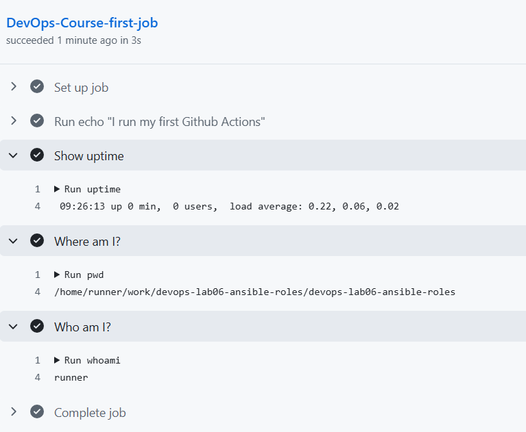

### Шаг 6. Настройка статического анализа кода с помощью ansible-lint
- Разработан боевой CI-пайплайн `.github/workflows/lint.yml`, срабатывающий при коммитах в ветку `master`.
- Пайплайн использует готовый экшен `actions/checkout@v4` для выкачивания репозитория и `ansible/ansible-lint@main` для аудита сценариев.
- Проанализирован отчет линтера в веб-интерфейсе GitHub Actions: зафиксированы замечания статического анализатора по стилю YAML и параметрам модулей.

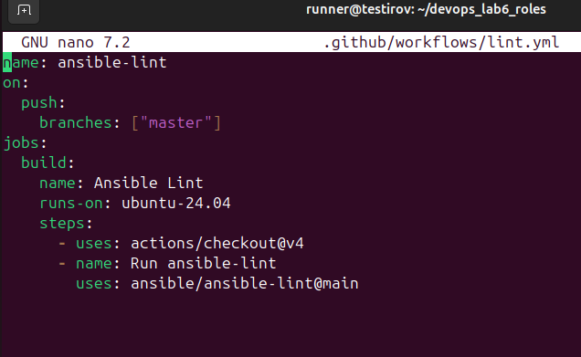
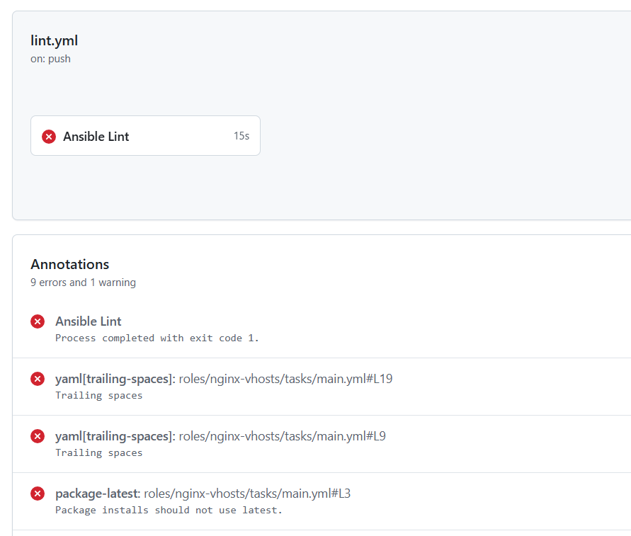